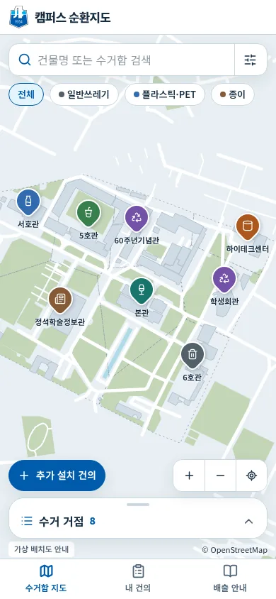
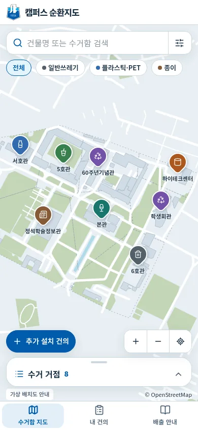

# 캠퍼스 순환지도의 모션

지도는 탐색의 기준점이다. 필터링·시트·탭·데이터 갱신은 지도 위의 UI에서 처리한다. 카메라 제어는 `CampusMap`에 남기고, 위치 선택과 목록 버튼의 명시적인 이동 요청을 구분한다.

| 모바일 지도, 변경 전 | 모바일 지도, 변경 후 |
| --- | --- |
|  |  |

## 토큰과 패턴

`app/tokens.css`의 CSS 시간 단위는 ms이고 `lib/motion.ts`의 Motion 시간 단위는 초다. `tests/motion.test.ts`가 두 쪽의 시간과 베지에 곡선을 대조한다.

| 토큰 | ms | 주 용도 |
| --- | ---: | --- |
| instant | 100 | 누름 |
| micro | 150 | 색과 퇴장 |
| fast | 200 | 숫자·체크·검색 |
| standard | 250 | 탭·콘텐츠 |
| panel | 300 | 하단 패널 |
| layout | 350 | 행 재배치 |
| emphasis | 450 | 서버가 확인한 변화 |
| shimmer | 1400 | 최초 로딩 자리 표시 |

CSS에서는 `var(--dur-fast)`, `var(--motion-enter)` 등을 사용한다. TypeScript에서는 `tween(duration.fast)`, `ease`, `distance`, `scale`, `spring`을 가져온다. 색·누름·체크·Radix의 열림/닫힘은 CSS가 담당한다. 위치가 변하는 행과 탭은 Motion의 layout 투영을 사용한다.

- `Swap`은 이전 패널을 잠시 겹쳐서 페이드하고 입력 및 접근성 트리에서 제외한다. `identity`에는 실제 화면이나 거점의 ID를 주고 `direction`에 전진 1, 후진 −1, 제자리 0을 준다.
- `ContentReveal`은 최초 데이터가 늦을 때만 스켈레톤을 표시한다. 데이터가 이미 있으면 재조회 및 오류 복구 중에도 같은 콘텐츠를 유지한다.
- `AnimatedNumber`는 현재 숫자를 한 번만 읽게 하고 시각적 숫자를 별도 레이어에서 전환한다. `StatusLabel`과 `useChangeHighlight`는 실제 상태나 점수가 달라진 항목에만 피드백을 준다.
- `useInstalledBins`는 필터 적용 전의 전체 스냅샷과 epoch를 비교한다. 최초 조회·필터 재선택·같은 데이터의 재조회와 신규 설치를 구분한다.

### 개별 화면의 확장

로컬 variants, keyframes, transition을 `Swap`에 그대로 전달할 수 있다. 새로운 패턴은 사용하는 화면에서 `motion.*`, `AnimatePresence` 또는 CSS로 작성하면 된다. 중앙 등록 과정은 없다.

```tsx
const reduce = useReducedMotion()
const local = {
  enter: { opacity: 0, y: reduce ? 0 : 6 },
  visible: { opacity: 1, y: 0 },
  leave: { opacity: 0 }
}
return (
  <Swap identity={sectionId} variants={local}
    transition={reduce ? { duration: 0 } : { ...spring, damping: 45 }}>
    {content}
  </Swap>
)
```

앱의 `MotionPolicy`가 운영체제의 모션 감소 설정을 따른다. 독자적인 CSS 애니메이션은 `prefers-reduced-motion` 처리도 함께 추가한다. 버튼 클릭, 포커스 복원, 데이터 반영은 모션 완료를 기다리지 않는다. Radix는 퇴장 프레임이 끝나면 포털을 해제한다.

## 적용 위치

| 영역 | 코드와 동작 |
| --- | --- |
| 01 하단 탭 | 학생 route group의 레이아웃이 내비게이션과 방문한 모바일 지도를 유지한다. 활성 링크의 `layoutId`가 아이콘과 라벨 전체를 따라간다. |
| 02 거점 상세 | 목록과 상세를 방향에 맞춰 교체하고 다른 핀은 같은 시트 안에서 교차 전환한다. 핸들 및 지도의 좌표계는 고정된다. |
| 03 건의 단계 | 진행 표시가 단계에 맞춰 채워지고 입력 영역만 이전·다음 방향으로 움직인다. |
| 04 제출 | 요청 중 버튼을 잠그고, 서버 응답에 따라 성공·오류를 구분한다. 신고를 재시도할 때 품목이 유지된다. |
| 05 내 건의 | ID별 행과 펼침 상태를 유지하고 상태 문구·완료 표시를 갱신한다. |
| 06 검색 목록 | 안정적인 거점 ID로 남는 행을 재배치하고 퇴장 행을 비활성화한다. |
| 07 확인 모달 | Radix 상태에 연결한 scrim·scale 전환과 12px 버튼 여백을 사용한다. |
| 08 배출 안내 | 하단 패널이 올라오며 품목 아이콘과 설명을 함께 표시한다. |
| 09 터치 | 실제 버튼 영역은 고정하고 눌린 표면과 내부 요소가 반응한다. |
| 10 거점 수 | 필터 결과 수만 짧게 굴러가며 주변 제목은 고정된다. |
| 11 품목 체크 | 체크 공간을 미리 확보하고 선택·해제 때 투명도와 크기를 바꾼다. |
| 12 빈 결과 | 아이콘과 초기화 동작을 제공한다. 빈 결과 사이에서 문구를 재마운트하지 않는다. |
| 13 검색 지우기 | 버튼 공간과 입력 포커스를 유지하며 지우기 동작의 가용성을 전환한다. |
| 14 관리자 | 실제 순위·점수·KPI·설치 상태 변화와 신규 핀을 표시한다. 기존 통계 계산과 막대를 사용한다. |
| 15 최초 로딩 | 건의와 거점 목록에 중립적인 자리 표시를 사용한다. |
| 16 콘텐츠 표시 | 자리 표시가 실제 목록 또는 빈 상태로 전환된다. 배경 갱신은 기존 UI를 유지한다. |

## 검증

README의 로컬 Supabase 환경에서 `npm run typecheck`, `npm run lint`, `npm test`, `npm run build`, `npm run test:e2e`를 실행한다. `CHROMIUM_PATH`로 시스템 Chromium을 지정할 수 있다. 모션과 서버 응답 순서만 재현하려면 다음 명령을 사용한다.

```sh
npm run test:e2e -- tests/e2e/motion.spec.ts --trace on
```

Playwright Trace에는 탭 이동, 실제 터치, API 응답과 전후 DOM이 함께 기록된다. 화면을 비교할 때는 글꼴 로딩과 유한한 애니메이션의 종료를 확인한다. 신고·승인·설치·초기화가 포함된 전체 테스트는 로컬 DB에서 실행한다.
