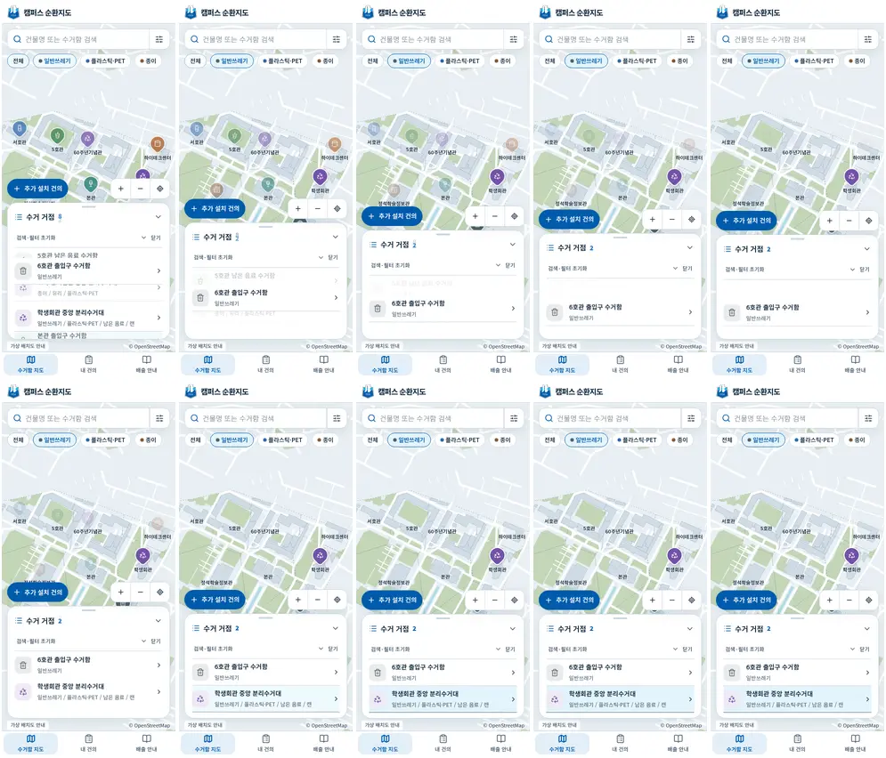

# 캠퍼스 순환지도의 모션

지도는 탐색의 기준점이다. 필터링·시트·탭·데이터 갱신은 지도 위의 UI에서 처리한다. 카메라 제어는 `CampusMap`에 남기고, 위치 선택과 목록 버튼의 명시적인 이동 요청을 구분한다.

| 모바일 지도, 변경 전 | 모바일 지도, 변경 후 |
| --- | --- |
|  |  |

## 토큰과 패턴

`app/tokens.css`의 CSS 시간 단위는 ms이고 `lib/motion.ts`의 Motion 시간 단위는 초다. `tests/motion.test.ts`가 두 쪽의 시간과 베지에 곡선을 대조한다.

| 토큰 | ms | 주 용도 |
| --- | ---: | --- |
| instant | 100 | 누름 |
| micro | 150 | 색과 퇴장 |
| fast | 200 | 숫자·체크·검색 |
| standard | 250 | 탭·콘텐츠 |
| panel | 300 | 하단 패널 |
| layout | 350 | 행 재배치 |
| emphasis | 450 | 서버가 확인한 변화 |
| shimmer | 1400 | 최초 로딩 자리 표시 |

CSS에서는 `var(--dur-fast)`, `var(--motion-enter)` 등을 사용한다. TypeScript에서는 `tween(duration.fast)`, `ease`, `distance`, `scale`, `spring`을 가져온다. 색·누름·체크·Radix의 열림/닫힘은 CSS가 담당한다. 하단 탭 표시기와 건의 이력 행은 Motion의 layout 투영을 사용한다. 거점 목록의 이동은 목록 안의 좌표로 계산한다.

- `Swap`은 이전 패널을 잠시 겹쳐서 페이드하고 입력 및 접근성 트리에서 제외한다. `identity`에는 실제 화면이나 거점의 ID를 주고 `direction`에 전진 1, 후진 −1, 제자리 0을 준다.
- `ContentReveal`은 최초 데이터가 늦을 때만 스켈레톤을 표시한다. 데이터가 이미 있으면 재조회 및 오류 복구 중에도 같은 콘텐츠를 유지한다.
- `AnimatedNumber`는 현재 숫자를 한 번만 읽게 하고 시각적 숫자를 별도 레이어에서 전환한다. `StatusLabel`과 `useChangeHighlight`는 실제 상태나 점수가 달라진 항목에만 피드백을 준다.
- `useInstalledBins`는 필터 적용 전의 전체 스냅샷과 epoch를 비교한다. 최초 조회·필터 재선택·같은 데이터의 재조회와 신규 설치를 구분한다.

### 개별 화면의 확장

로컬 variants, keyframes, transition을 `Swap`에 그대로 전달할 수 있다. 새로운 패턴은 사용하는 화면에서 `motion.*`, `AnimatePresence` 또는 CSS로 작성하면 된다. 중앙 등록 과정은 없다.

```tsx
const reduce = useReducedMotion()
const local = {
  enter: { opacity: 0, y: reduce ? 0 : 6 },
  visible: { opacity: 1, y: 0 },
  leave: { opacity: 0 }
}
return (
  <Swap identity={sectionId} variants={local}
    transition={reduce ? { duration: 0 } : { ...spring, damping: 45 }}>
    {content}
  </Swap>
)
```

앱의 `MotionPolicy`는 미디어 쿼리 변경을 구독한다. 화면을 열어 둔 채 운영체제의 모션 감소 설정을 바꿔도 마운트된 패널과 행에 적용한다. 독자적인 CSS 애니메이션은 `prefers-reduced-motion` 처리도 함께 추가한다. 버튼 클릭, 포커스 복원, 데이터 반영은 모션 완료를 기다리지 않는다. Radix는 퇴장 프레임이 끝나면 포털을 해제한다.

## 필터와 시트

필터 선택 한 번이 최신 거점 ID, 개수, 목록, 핀을 함께 결정한다. `StationList`는 거점 ID를 키로 유지하고, 순서가 바뀔 때 목록 안의 이전·최종 `offsetTop`을 비교한다. 남은 행은 자기 슬롯 안에서 최대 8px 이동한다. 새 행과 퇴장 행은 150ms 동안 투명도를 전환한다. 퇴장 슬롯은 정상 흐름에서 빠지며 입력·포커스·접근성 트리에서 제외된다. 앞쪽의 불투명한 슬롯과 클리핑이 서로 다른 행의 글자가 한 자리에 그려지는 것을 막는다.

`StationSheet`가 핸들, 본문, 가용 높이를 측정해 목표 높이를 소유한다. 짧은 결과에서는 겹치는 스냅을 합치고, 필터를 지워 목록이 길어지면 사용자가 고른 확장 상태로 돌아간다. 드래그가 우선이며 새 필터나 드래그가 시작되면 이전 행 이동 애니메이션을 취소한다. 전체 품목 패널은 선택 즉시 필터를 반영하고, 퇴장 중 입력을 막고, 연 버튼으로 포커스를 돌려준다.

같은 순서로 '전체 → 일반쓰레기'를 선택한 중간 프레임이다. 윗줄은 수정 전, 아랫줄은 수정 후다. 수정 전에도 목표 높이는 한 번만 바뀌었지만 퇴장 텍스트가 이동하는 행과 교차했다.



## 최초 조회와 상태 갱신

- `ContentReveal`은 최초 조회에만 자리를 확보하고 240ms가 지난 뒤 스켈레톤을 그린다. 거점 목록은 아이콘과 두 줄짜리 행 세 개, 건의 이력은 제목·상태·날짜 자리를 가진 카드 두 개를 사용한다. 준비된 목록, 빈 결과, 복구 가능한 오류로 짧게 전환한다. 건의 행은 최대 105ms까지만 시차를 둔다.
- 장식용 셰이프의 `aria-hidden`은 스크린 리더에만 영향을 준다. 시머를 일시 정지하는 조건은 숨은 지도, 접힌 거점 시트, 퇴장 중인 패널이다. 모션 감소 설정에서는 정적인 자리 표시를 사용한다.
- Realtime의 구독 상태는 연결 복구와 주기 조회에 사용한다. 연결 상태 문구나 예약 여백은 그리지 않는다. 기존 데이터가 있을 때 재조회하면 열린 항목과 콘텐츠를 유지하고, 조회·제출 오류에는 오류 문구와 재시도를 제공한다.

## 탭, 터치, 통계

하단 표시기는 아이콘과 글자를 함께 감싼다. 목적지 본문은 불투명한 표면 위에서 진입한다. 이전 문구의 비트맵은 남기지 않는다. 지도 인스턴스는 보존하며 비활성 레이어에는 `inert`, 투명도, 가시성, 입력 차단을 함께 적용한다. 필터 패널에서 선택하면 결과와 조작 가능 상태를 즉시 갱신하고 시트 높이와 제목의 전환을 기존 모션 토큰으로 연결한다. 모션 감소 설정에서는 바로 새 상태를 표시한다.

`PressButton`의 크기와 포커스는 바깥의 네이티브 버튼이 담당한다. 색·테두리·아이콘·텍스트를 가진 안쪽 `.press-face`만 함께 축소한다. 칩은 기존 `.chip-pill`을 같은 표면으로 사용한다. 선택 상태별 배경과 테두리는 `--press-fill`과 `--press-rule`로 지정한다.

관리자의 적재 상태 막대는 다섯 구간을 유지한다. 서버 수치를 즉시 범례에 반영하고 기존 구간의 `flex-grow`를 300ms 동안 새 값으로 전환한다. 0건 구간은 너비가 0이며, 새 데이터가 도착하면 현재 너비에서 이어간다. 모션 감소 설정에서는 즉시 반영한다.

## 적용 위치

| 영역 | 코드와 동작 |
| --- | --- |
| 01 하단 탭 | 학생 route group의 레이아웃이 내비게이션과 방문한 모바일 지도를 유지한다. 활성 링크의 `layoutId`가 아이콘과 라벨 전체를 따라간다. |
| 02 거점 상세 | 목록과 상세를 방향에 맞춰 교체하고 다른 핀은 같은 시트 안에서 교차 전환한다. 핸들 및 지도의 좌표계는 고정된다. |
| 03 건의 단계 | 진행 표시가 단계에 맞춰 채워지고 입력 영역만 이전·다음 방향으로 움직인다. |
| 04 제출 | 요청 중 버튼을 잠그고, 서버 응답에 따라 성공·오류를 구분한다. 신고를 재시도할 때 품목이 유지된다. |
| 05 내 건의 | ID별 행과 펼침 상태를 유지하고 상태 문구·완료 표시를 갱신한다. |
| 06 검색 목록 | 안정적인 거점 ID로 남는 행을 재배치하고 퇴장 행을 비활성화한다. |
| 07 확인 모달 | Radix 상태에 연결한 scrim·scale 전환과 12px 버튼 여백을 사용한다. |
| 08 배출 안내 | 하단 패널이 올라오며 품목 아이콘과 설명을 함께 표시한다. |
| 09 터치 | 실제 버튼 영역은 고정하고 눌린 표면과 내부 요소가 반응한다. |
| 10 거점 수 | 필터 결과 수만 짧게 굴러가며 주변 제목은 고정된다. |
| 11 품목 체크 | 체크 공간을 미리 확보하고 선택·해제 때 투명도와 크기를 바꾼다. |
| 12 빈 결과 | 아이콘과 초기화 동작을 제공한다. 빈 결과 사이에서 문구를 재마운트하지 않는다. |
| 13 검색 지우기 | 버튼 공간과 입력 포커스를 유지하며 지우기 동작의 가용성을 전환한다. |
| 14 관리자 | 실제 순위·점수·KPI·설치 상태 변화와 신규 핀을 표시한다. 기존 통계 계산과 막대를 사용한다. |
| 15 최초 로딩 | 건의와 거점 목록에 중립적인 자리 표시를 사용한다. |
| 16 콘텐츠 표시 | 자리 표시가 실제 목록 또는 빈 상태로 전환된다. 배경 갱신은 기존 UI를 유지한다. |

## 검증

README의 로컬 Supabase 환경에서 `npm run typecheck`, `npm run lint`, `npm test`, `npm run build`, `npm run test:e2e`를 실행한다. `CHROMIUM_PATH`로 시스템 Chromium을 지정할 수 있다. 모션과 서버 응답 순서만 재현하려면 다음 명령을 사용한다.

```sh
npm run test:e2e -- tests/e2e/motion.spec.ts tests/e2e/filter-motion.spec.ts tests/e2e/tab-layers.spec.ts --trace on
```

Playwright Trace에는 탭 이동, 실제 터치, API 응답과 전후 DOM이 함께 기록된다. 화면을 비교할 때는 글꼴 로딩과 유한한 애니메이션의 종료를 확인한다. 신고·승인·설치·초기화가 포함된 전체 테스트는 로컬 DB에서 실행한다.


`filter-motion.spec.ts`는 필터 선택 전부터 매 프레임의 시트 높이, 목표값, 지도 크기, 표시 중인 행, 퇴장 행의 입력 상태를 기록한다. Trace의 `filter-frames.json` 첨부물에서 수치를 볼 수 있다. 로컬 fixture로 8→2→8, 3→0→전체와 연속 입력을 재현한다. 실제 SDK 검증에는 승인된 도메인을 사용한다. 아래 목록은 읽기 전용이며, 지도 인스턴스, 중심 좌표, 줌, 복귀 후 탐색 상태와 최종 화면의 픽셀을 비교한다.

```sh
KAKAO_SMOKE_URL=https://trash-map-demo.vercel.app npm run test:e2e -- tests/e2e/tab-layers.spec.ts tests/e2e/filter-motion.spec.ts --trace on
```


업무 흐름은 격리된 DB에서 `npm run test:e2e -- tests/e2e/task-oriented-ux.spec.ts tests/e2e/booth.spec.ts --trace on`으로 검증한다. 실제 SDK의 읽기 전용 확인에는 `KAKAO_SMOKE_URL`을 설정해 `task-oriented-ux.spec.ts`, `tab-layers.spec.ts`, `filter-motion.spec.ts`만 실행한다. [화면 변경 전후와 품목 탐색](booth-journey.webp)

## 지도 선택과 검색

| 사용자 행동 | 화면과 데이터의 변화 |
| --- | --- |
| 숫자 핀 누르기 | 현재 표시 중인 실제 거점의 선택 목록을 연다. 같은 구역에 속할 때만 제목에 건물명을 넣는다. 그룹과 개별 핀을 직접 열 때는 카메라를 유지한다. |
| 목록·대안·설치 완료 바로가기 선택 | 선택한 ID를 상세에 연결한다. 해당 핀 또는 그룹 대표가 가시 영역 밖이거나 데스크톱 조작 버튼에 가려졌을 때만 기존 배율로 이동한다. |
| 품목 검색 | 공백 단위 AND와 NFKC 정규화를 적용한다. 도서관은 정석학술정보관, 페트병·PET병·생수병은 플라스틱으로 해석한다. 검색 결과는 실제 설치 품목을 기준으로 필터링한다. 커피만으로 재질을 결정하지 않고 음료 검색 또는 기존 컵 재질 가이드로 연결한다. |
| 품목별 거점 비교 | 명시적 필터, 사용자가 선택한 품목, 검색에서 확인한 단일 품목 순으로 컨텍스트를 적용한다. 전체 칩의 표시와 입력값을 유지하면서 행에 해당 품목의 측정값을 표시하고 상세의 첫 품목과 새 건의의 기본 품목을 정한다. |
| 탐색 중 새 센서값 수신 | 새 탐색에서만 여유→보통→혼잡→가득 참→정보 없음 순으로 정렬한다. 같은 탐색에서는 수치와 상태를 즉시 갱신하고 기존 행 순서를 유지한다. 삭제된 행은 제거하고 새 거점은 뒤에 추가한다. |
| 가득 찬 품목의 대안 선택 | 같은 품목에서 여유가 측정된 다른 거점 중 같은 구역, 거리, 포화도, ID 순으로 최대 두 곳을 표시한다. 추천할 수 없으면 그 사실을 표시한다. 선택 시 같은 상세 시트에서 전환하며 대상과 충돌하는 검색 조건만 해제한다. |

`lib/marker-groups.ts`는 실제 ID와 화면 투영 함수를 받아 48 CSS px 터치 사각형이 이어지는 거점들을 구성한다. 같은 좌표도 별도의 실제 거점으로 남는다. 정렬한 멤버 ID가 그룹 키를 결정하고 첫 멤버의 실제 좌표가 대표 위치가 된다. Kakao CustomOverlay는 SDK 투영을 사용하고 가상 배치도는 자체 축척을 적용한다. 팬은 모든 핀을 같은 양만큼 이동시킨다. 확대·축소나 표시 데이터 변경 시 소속을 다시 계산한다. 후보 위치는 별도 핀으로 유지한다.

`CampusMap`의 `groupContent(ids, close)`를 제공하는 화면만 그룹 선택을 사용한다. 관리자 지도는 건의 ID와 거점 ID를 구분해 원본으로 연결하고 신고를 거점의 품목별로 집계한다. 건물 전환 시 같은 지도에서 경계와 핀을 갱신한다. 명시적인 건물 선택만 가시 영역을 검사해 필요한 경우 Reveal을 요청한다.

`reveal(point, visible)`는 대상과 실제 가시 영역을 받는다. 목록, 추천, 명시적 바로가기에서 호출하며 타일 지도와 배치도는 같은 가시성 판정을 사용한다. 직접 조작은 진행 중인 이동보다 우선한다. 그룹 전환에서는 이전 타깃의 입력을 즉시 차단하고 선택 강조는 ID가 바뀔 때 한 번 실행한다. 리스트와 상세는 기존 Motion 토큰 및 Reduced Motion 설정을 사용한다. 가로 시트의 절반 높이는 첫 결과 행과 제목·도구의 실측 높이를 반영한다.

건의는 해당 탭의 sessionStorage에 epoch와 함께 위치, 품목, 사유, 단계를 저장한다. 목록·안내·새로고침에서 복원하며 취소 확인, 제출 성공, epoch 변경 시 정리한다. 관리 구역 밖 탭은 경고만 표시하고 유효 좌표와 후보 핀을 유지한다. 작은 화면에서도 위치 선택 결과를 다음 버튼 옆에서 확인할 수 있다.

`npm test`에서 그룹·별칭·추천·순서 안정성 단위를 검증한다. 로컬 Supabase로 `npm run test:e2e`를 실행하면 관리자 시나리오도 함께 검증한다. 실제 SDK는 Kakao에 등록한 도메인에서 `KAKAO_SMOKE_URL=https://<등록한-도메인> npm run test:e2e -- phase-one tab-layers filter-motion task-oriented-ux`로 검증한다. Phase 1의 겹침·포화도 경계값은 브라우저 GET 응답 fixture로 제공한다. 데이터 변경을 포함하는 booth 테스트는 로컬 Supabase에서만 실행한다.


관리자 순위는 구역 ID를 키로 사용한다. 위치는 Layout 350ms로 재배치하고 건의·신고 ID 변화가 확인된 행만 Emphasis 450ms로 한 번 강조한다. 현재 점수와 마지막 변화 이유, 지속적인 선택 표시를 분리한다. 같은 점수에서도 서로 상쇄된 접수와 처리를 확인할 수 있다. 센서 저장 눈금과 차트의 막대·선·점은 최신 스냅샷 수치로 갱신한다. Reduced Motion에서는 이동 없이 최종 값을 읽는다.

로컬 Supabase에서 `tests/e2e/booth.spec.ts`는 학생 두 명과 운영자가 신고·건의부터 신규 설치, 학생의 실제 설치 거점 열기까지 진행한다. `admin-workflow.spec.ts`는 독립된 읽기 응답으로 순위 원인, 건물별 초안, 만료된 승인 대상, 미측정과 실제 0%, 저장 결과를 재현한다.

[1366×768 변경 전 첫 화면](admin-before.webp) · [변경 후 첫 화면](admin-workbench.webp). 변경 전 화면은 로컬 시드, 변경 후 화면은 건의와 신고가 같은 위치에 있는 QA 데이터를 표시한다.

## 학생과 운영자가 같은 변화를 읽는 방법

지도 위 검색·시트는 흰색 표면과 기존 그림자를 사용합니다. 일반 학생 화면은 바탕색과 얇은 구분선으로 목록을 나눕니다. 운영 화면의 패널은 순위·지도·측정값 작업 단위로 묶습니다. `#005BAC`은 선택·주요 행동, `#00AFEC`은 새 데이터의 강조선과 변화 구역에 씁니다. 품목 아이콘과 포화 상태는 기존 의미 색상을 사용합니다.

- 모바일 상세 시트는 목록 복귀, 드래그 가능한 거점명, 닫기를 한 행에 놓습니다. 검색 결과 제목은 필터와 같은 품목 아이콘을 사용합니다. 지도 그룹의 숫자는 실제 항목 수이며 경고 아이콘의 신고 수는 별도로 합산합니다.
- 여섯 배출 안내의 SVG는 내용물 비우기·라벨 떼기·상자 펼치기 등 품목별 동작을 나타냅니다. 삽화가 실제로 보일 때 560ms 동안 한 번 재생하며 모션 감소 환경에서는 완성된 정지 그림을 보여줍니다. 설명과 지도 링크는 즉시 사용할 수 있습니다.
- 내 건의 첫 줄에 건물·상태, 둘째 줄에 품목·접수 시각을 배치합니다. 펼친 이력은 접수증과 실제 레코드를 공유합니다. 설치 링크는 승인된 거점 ID를 전달합니다.
- 순위 행은 건물 선택과 산식 펼침을 독립 버튼으로 제공합니다. 집계 항의 하이라이트는 해당 숫자가 바뀔 때만 실행됩니다. 단면의 저장 수위는 서버 확인값을 기준으로 이동합니다. 감소 예정 구간은 반대 방향 빗금과 부호로 표시합니다.
- 같은 epoch의 연속 스냅샷에서 건의·신고·설치안 ID, 상태와 센서 읽기를 비교합니다. 최초 조회는 기준점으로 삼습니다. 한 조회 구간에서 구역·유형이 같은 사건을 묶고 점수와 순위는 그 구간 합계로 한 번만 표시합니다. 운영자와 관람객은 동일한 사건을 읽습니다. 대기 중 최근 24묶음을 보관하고 초과분은 건물·종류별 건수로 요약합니다. 초기화 시 기존 대기열을 비웁니다.
- 모드를 전환해도 운영 컴포넌트와 카메라는 유지됩니다. 관람객 지도는 자체 카메라를 사용합니다. 새 사건을 확인할 때 해당 구역을 잠깐 강조하고 수신 때문에 지도를 이동시키지 않습니다.
