# 학생 참여와 관람객 화면

관람객 화면은 인증된 운영자가 보는 캠퍼스 전체 지도와 설치 우선순위 상위 세 건물입니다. 아래 장면에서 5호관의 종이 설치 건의 한 건이 접수되어 같은 조회 구간에 점수가 3점 올랐습니다. 지도 타일은 실제 Kakao Maps SDK로 불렀고, 업무 데이터는 격리된 검증 환경에서 제공했습니다.

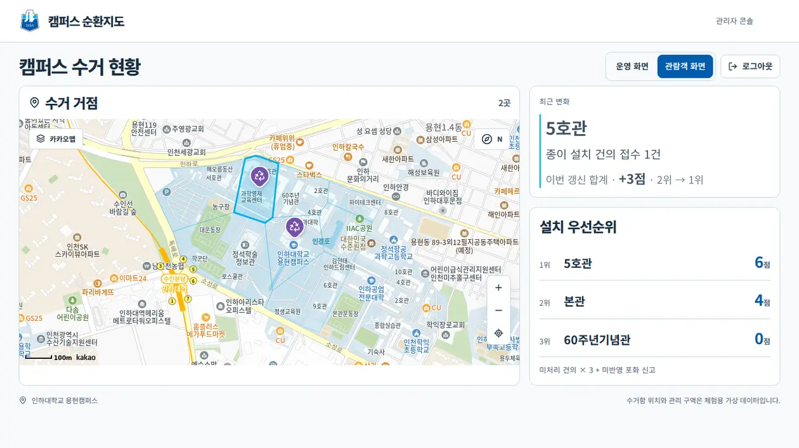

| 변경 범위 | 적용 내용 |
| --- | --- |
| A-01~03 | 선택·주요 행동과 데이터 변화의 색을 구분하고, 지도 위 조작부·학생 읽기 화면·운영 패널의 표면과 글자 위계를 조정했습니다. |
| A-04~06 | 그룹의 항목 수와 신고 수를 구분했습니다. 순위표의 숫자 열을 고정하고 상세 시트의 목록·거점명·닫기를 한 줄에 배치했습니다. |
| A-07~08 | 내 건의 요약을 두 줄로 정리하고 기존 탭 이동·누름·숫자·시트 전환과 모션 감소 설정을 활용했습니다. |
| B-01~02 | 필터와 결과에 동일한 품목 아이콘을 쓰고 실제로 매칭된 건물 별칭을 표시합니다. 여섯 SVG 삽화는 각 품목의 배출 동작을 보여줍니다. |
| B-03~04 | 작성 단계에서 위치와 품목이 이어집니다. 접수증·처리 이력·설치 결과는 방문자의 건의 레코드를 읽고, 재신고 시각은 같은 방문자·거점·품목의 서버 제한을 읽습니다. |
| C-01~03 | 건물 선택과 독립된 점수 산식, 설치 품목 비교, 저장값과 예정값을 분리한 센서 단면을 추가했습니다. |
| D-01~03 | 운영 화면과 관람객 화면이 한 스냅샷을 구독합니다. 읽는 사건을 유지하면서 새 사건을 대기열에 모으고 지도와 순위는 최신값을 보여줍니다. |

## 화면 비교

| 화면 | 변경 전 | 변경 후 |
| --- | --- | --- |
| 수거 거점 상세 | 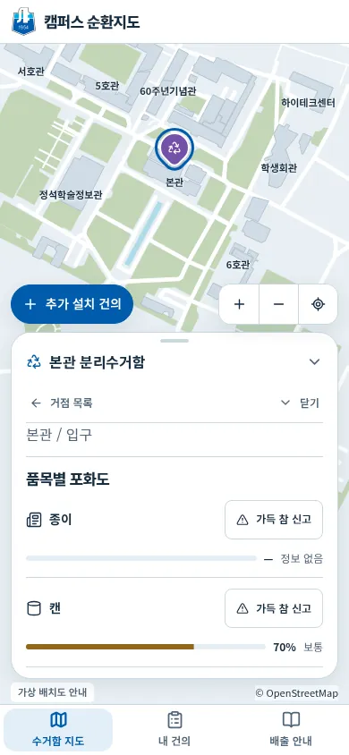 | 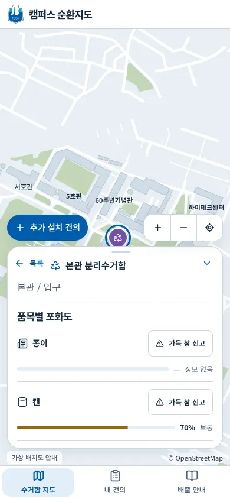 |
| 운영 대시보드 | 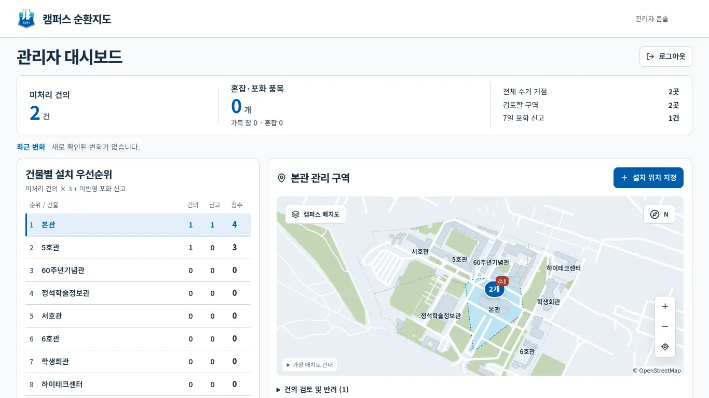 | 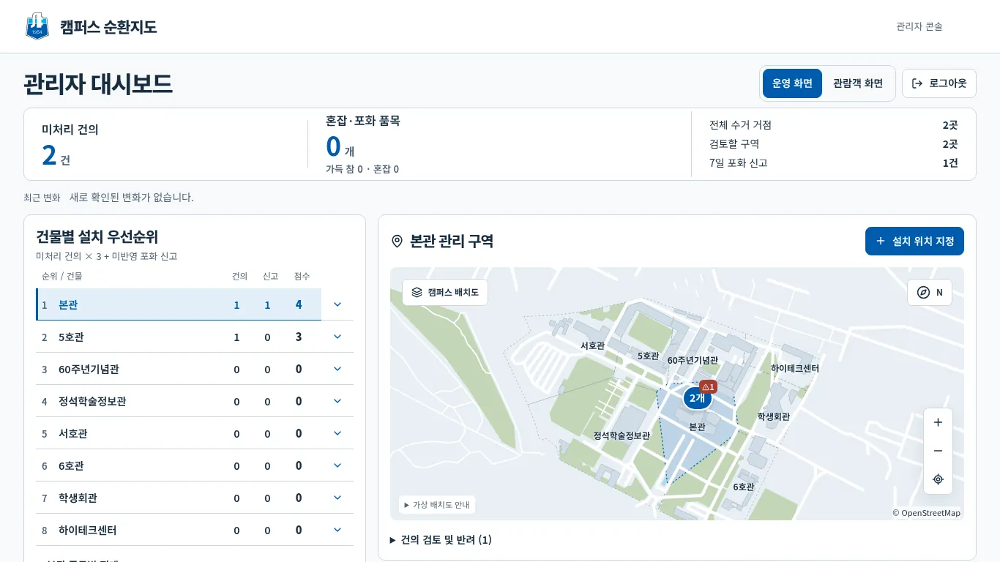 |

| 위치와 품목을 선택한 뒤 | 서버가 확인한 접수증 | 내 건의에서 같은 접수 확인 |
| --- | --- | --- |
| 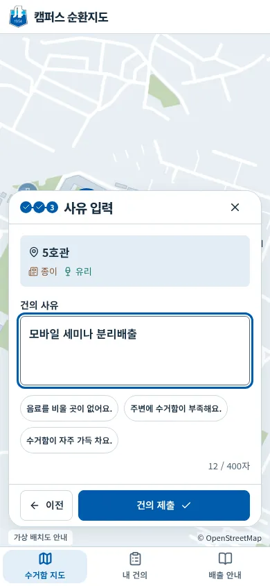 | 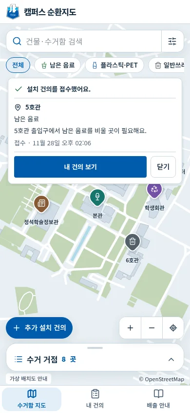 | 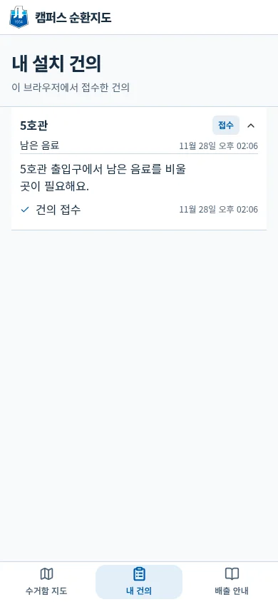 |

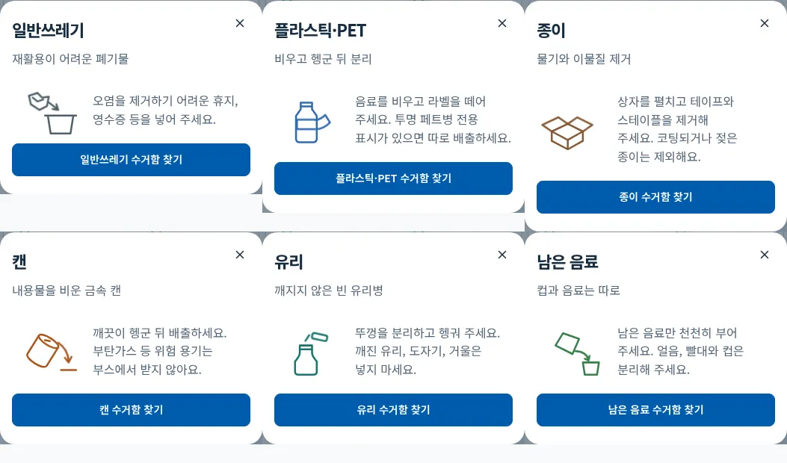

| 점수 산식 | 승인할 품목 비교 | 센서 단면과 조작부 |
| --- | --- | --- |
| 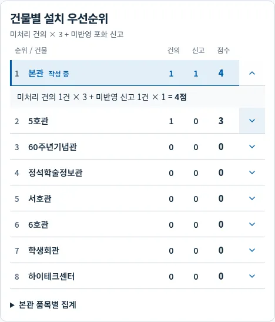 | 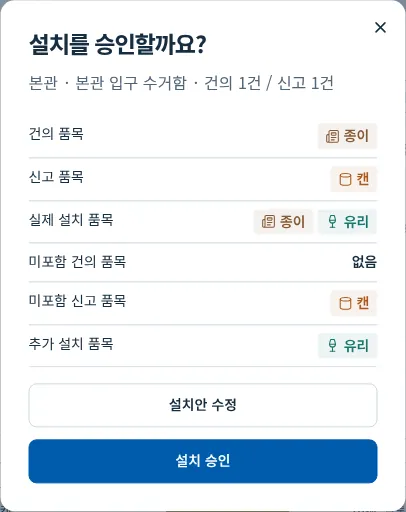 | 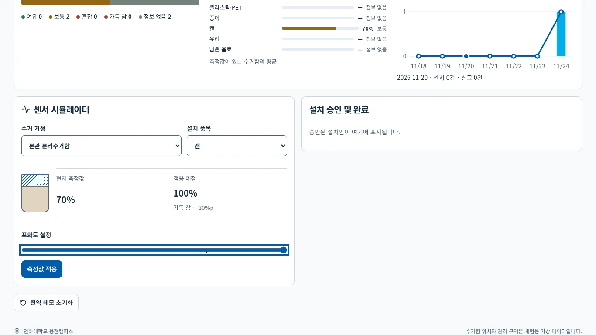 |

## 재현 환경

- 쓰기 검증은 로컬 PostgreSQL·Supabase에서 실행했습니다. 학생 두 명과 관리자를 독립 브라우저 컨텍스트로 접속시켜 건의·동시 신고·설치 승인과 완료·센서 변경과 재연결을 검증했습니다. SQL 테스트는 PGlite에서 방문자 격리와 정확한 제한 종료 시각, 제한 만료, epoch 변경을 검증합니다.
- 학생 지도·내 건의·배출 안내는 Chromium에서 320×568, 360×640, 375×667, 390×844, 412×915, 430×932, 454×312, 844×390으로 렌더링했습니다. 운영·전시 화면은 1280×720, 1366×768, 1440×900, 1920×1080, 768×1024, 390×844에서 점검했습니다.
- 실제 Kakao SDK 검증에서 참여자 화면의 지도 이동, 선택, 탭 전환과 운영자의 그룹 선택, 후보 위치, 전시 지도 타일, 구역 표시, 운영 지도 중심·줌 복원을 확인했습니다. 실제 단말 Safari·Samsung Internet은 별도 확인 대상입니다.
- Hallmark의 정적 검사와 Chromium 렌더 검사를 함께 실행했습니다. 독립 시각 검토 후 관람객 화면의 제목과 변화량, 넓은 화면의 순위 글자 크기, 모바일 목록 복귀 레이블을 수정했습니다. 고정 동작 영역·스케일·저작권과 긴 접수증의 링크도 실제로 조작해 확인했습니다.
